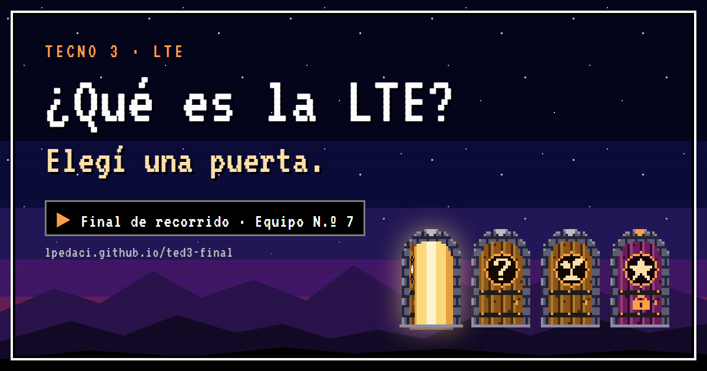

# Final de recorrido · ¿Qué es la LTE?

Experiencia de aprendizaje interactiva desarrollada por el **Equipo N.º 7 (Enlace Pedagógico)** como desafío creativo de cierre de *Tecnología Educativa III*, Licenciatura en Tecnología Educativa (UTN, 2026).

El sitio responde a la pregunta *¿Qué es la LTE?* a través de un recorrido con estética de videojuego de 8 bits: cuatro puertas y tres llaves. Cada una de las tres primeras puertas propone una actividad breve sobre la trayectoria del equipo; al completarla se obtiene una llave, y con las tres se desbloquea la puerta final, que integra la respuesta. Ada, la asistente que creó el equipo, acompaña el recorrido como guía.

**Sitio publicado:** https://lpedaci.github.io/ted3-final/



---

## Documentación

| Documento | Contenido |
|---|---|
| [Diseño instruccional](docs/diseno-instruccional.md) | Propósito, público, secuencia de actividades, retroalimentación, rol de Ada y marco TPACK. |
| [Guía de estilo](docs/guia-de-estilo.md) | Paleta, tipografías, componentes, pixel art, movimiento y puntos de corte. |
| [Accesibilidad y QA](docs/accesibilidad-y-qa.md) | Criterios aplicados, contraste, teclado, lectores de pantalla y pruebas realizadas. |
| [Mantenimiento](docs/mantenimiento.md) | Cómo editar textos, regenerar imágenes, actualizar versiones y publicar. |
| [Historial de cambios](CHANGELOG.md) | Evolución del proyecto. |

## En síntesis

- **Recorrido no lineal** de tres actividades y una síntesis final con producción propia.
- **Retroalimentación inmediata:** reformulaciones, avisos de error sin penalización y llaves que marcan el avance.
- **Ada como guía:** se presenta en la primera visita, ofrece la consigna de cada sala, celebra los logros y señala los errores.
- **Estética de aventura de 8 bits**, original: puertas en pixel art generadas por código, cajas de diálogo y HUD de llaves.
- **Legibilidad y accesibilidad:** contraste AA o superior, navegación con teclado, anuncios para lectores de pantalla y movimiento reducido.
- **Responsive** de 320 px a escritorio, sin desplazamiento lateral.
- **Listo para compartir:** og-card, íconos, datos estructurados, `robots.txt`, `sitemap.xml` y página 404.

## Estructura del proyecto

```
.
├── index.html            Página principal: marcado, metadatos SEO y contenedores
├── 404.html              Página de error con la estética del sitio
├── robots.txt            Indicaciones para buscadores
├── sitemap.xml           Mapa del sitio
├── site.webmanifest      Manifiesto (nombre, colores e íconos al instalar)
├── css/
│   └── styles.css        Estilos: tokens, escena, HUD, puertas, salas, Ada y responsive
├── js/
│   ├── content.js        Contenido textual del recorrido (EQUIPO y T)
│   ├── avatars.js        Avatares del equipo
│   ├── doors.js          Puertas y llave en pixel art (SVG generado por código)
│   ├── ada.js            Ada, asistente del equipo, como guía flotante
│   └── app.js            Estado, render de cada sala e interacción
├── assets/
│   ├── favicon.svg           Ícono de la pestaña
│   ├── og-card.png           Imagen para compartir en redes (1200 × 630)
│   ├── icon-192.png          Ícono para Android
│   ├── icon-512.png          Ícono para Android e instalación
│   └── apple-touch-icon.png  Ícono para iPhone y iPad (180 × 180)
├── tools/                Fuentes HTML de la og-card y del ícono (no se indexan)
├── docs/                 Documentación del proyecto
├── CHANGELOG.md          Historial de cambios
└── README.md
```

El contenido está separado de la presentación y de la lógica: los textos viven en `js/content.js`. Los scripts son clásicos (`defer`) y se cargan en orden, sin proceso de compilación.

## Uso local y publicación

```bash
python -m http.server 5173
```

Luego abrir `http://localhost:5173`. El sitio también funciona abriendo `index.html` directamente.

La publicación se hace en **GitHub Pages** desde la rama `main`, carpeta raíz: cada `push` a `main` se publica en uno o dos minutos. El detalle está en [Mantenimiento](docs/mantenimiento.md).

## Equipo

| Integrante | Perfil | Enlaces |
|---|---|---|
| **Silvia Costas** | Nivel inicial | [LinkedIn](https://www.linkedin.com/in/silvia-costas/) |
| **Lourdes Pedaci** | Informática, secundaria técnica | [LinkedIn](https://www.linkedin.com/in/lourdes-pedaci/) · [Portfolio](https://lpedaci.github.io/portfolio/) · [GitHub](https://github.com/lpedaci) |
| **Clara Argüello** | Preceptora y economía | [LinkedIn](https://www.linkedin.com/in/clara-arg%C3%BCello-684894367/) |

## Créditos y dependencias

- **Ada:** asistente creada por el equipo Enlace Pedagógico para la cursada «IA Generativa en el Aula». Logo original del equipo.
- **Tipografías:** VT323 y Figtree, vía Google Fonts.
- **Avatares:** [Micah](https://www.dicebear.com/styles/micah/), de Micah Lanier, licencia [CC BY 4.0](https://creativecommons.org/licenses/by/4.0/), servidos por la API de DiceBear (requieren conexión).
- **Puertas, íconos y og-card:** diseño propio del proyecto.

## Referencia

Koehler, M. J., & Mishra, P. (2009). What is technological pedagogical content knowledge? *Contemporary Issues in Technology and Teacher Education, 9*(1), 60–70.
